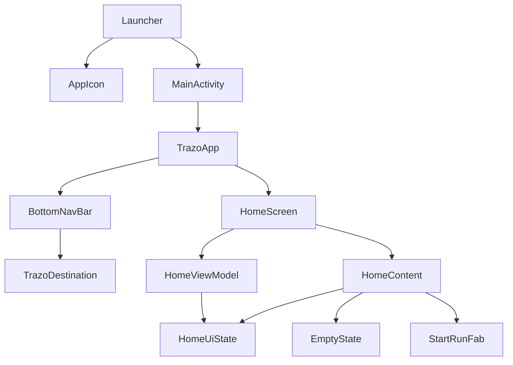
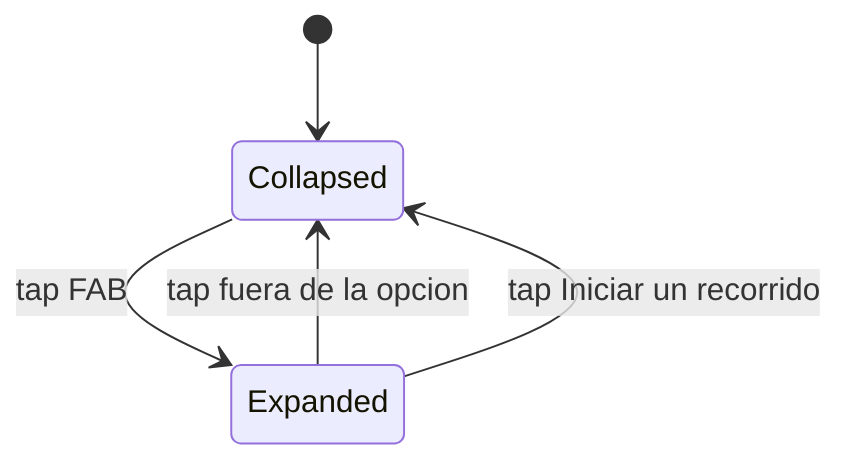

# Design Document · home-recent-runs

## Overview

**Propósito:** el corredor que abre Trazo por primera vez ve el logo de la marca y llega a un Inicio claro. La sección de actividad reciente aparece vacía, hay un botón "+" para empezar un recorrido y la barra de navegación muestra dónde está.

**Usuarios:** corredores recreativos que todavía no guardaron recorridos.

**Impacto:**
- Se reemplaza el placeholder de `HomeScreen` por la estructura `Screen` / `Content` / `ViewModel` / `UiState` que piden las reglas del proyecto.
- El ícono de la app pasa a ser el logo de Trazo. Desde Android 12, el sistema lo muestra al abrir la app.
- `BottomNavBar` se alinea con el sistema de diseño: indicador primaryContainer, ícono relleno y etiqueta en negrita en el ítem activo, y textos en `strings.xml`.

### Goals
- El logo de Trazo como ícono de la app, visible al abrirla en Android 12+, sin espera agregada (1.1–1.4).
- Estado vacío de Inicio con ilustración y "Todavía no hay recorridos" (2.1–2.3).
- FAB "+" habilitado que muestra la opción "Iniciar un recorrido" y se cierra al tocar afuera (3.1–3.5).
- Barra de navegación con Inicio acentuado y una selección que no depende solo del color (4.1–4.5).

### Non-Goals
- Abrir el modal "Iniciar nuevo recorrido" o registrar un recorrido. La opción invoca un callback que en esta spec no hace nada.
- Persistir o leer recorridos (Room, repositorios, modelo de dominio).
- Listar cards de recorridos, "Ver todo" y la pantalla de Configuración (el botón de la barra superior no navega).
- El contenido de Mapa e Historial.
- Deshabilitar el FAB durante un recorrido. El estado existe en el `UiState`, pero ninguna fuente lo cambia.
- Una pantalla de carga: no hay pantalla, librería (`core-splashscreen`), tema de arranque ni cambios en `MainActivity`.
- Íconos rasterizados para API 24–25. Los `.webp` de `mipmap-*dpi` se regeneran a mano (ver Open Questions).

## Boundary Commitments

### This Spec Owns
- El ícono adaptativo de la app (`ic_launcher_foreground` y `ic_launcher_background`).
- La pantalla de Inicio en su estado vacío: `HomeScreen`, `HomeContent`, `HomeViewModel` y `HomeUiState`.
- Los componentes `EmptyState`, `StartRunFab` y `TrazoTopBar`, que nacen en `ui/screens/home/components/`.
- La barra superior de Inicio (5.x) y el estilo de la barra de estado del sistema (íconos claros).
- El aspecto y los textos de `BottomNavBar` y `TrazoDestination`.
- Los strings y drawables nuevos que se listan en el File Structure Plan.

### Out of Boundary
- Qué pasa al elegir "Iniciar un recorrido". `TrazoApp` pasa un callback vacío.
- La fuente de datos de recorridos y el estado "recorrido en curso". `HomeUiState` arranca vacío y con el FAB habilitado.
- Mover `EmptyState` o `StartRunFab` a `ui/components/common/`. Eso lo hace la historia de la segunda pantalla que los use.
- Los colores del logo entregado. Se usa tal cual (ver Open Questions).
- La apariencia del arranque que dibuja el sistema: fondo, animación y duración. No se configura.

### Allowed Dependencies
- `ui/screens/home` → `ui/screens/home/components`, `ui/theme`, `R` (strings y drawables). **No** importa `ui/navigation`, `data`, ni componentes de otras pantallas.
- `ui/screens/home/components` → solo `ui/theme` y `R`. No conocen el ViewModel.
- `ui/navigation` → `ui/screens/*`, `ui/theme` y `R`.
- Librerías: Compose BOM 2025.04.01 (Material 3 1.3.x), Navigation Compose 2.8.9, Hilt 2.60.1 con `hilt-navigation-compose` 1.2.0, y la nueva `lifecycle-runtime-compose` 2.8.7.

### Revalidation Triggers
- Si `HomeUiState` suma campos de datos reales (lista de recorridos o recorrido en curso), hay que revalidar 2.x y 3.1–3.2.
- Si `HomeScreen` cambia de firma (por ejemplo, `onStartRunClick` pasa a navegar a un modal), se revisa `TrazoApp`.
- Si `EmptyState` o `StartRunFab` pasan a `common/`, se revisan sus imports desde Inicio, Mapa e Historial.
- Si cambia `TrazoDestination` (rutas, íconos o labels), se revisan `BottomNavBar` y el `NavHost`.
- Si cambia el ícono de la app (`mipmap-anydpi-v26/ic_launcher*.xml` o sus drawables), se revisa el arranque en Android 12+.

## Architecture

### Existing Architecture Analysis
- Hay una sola Activity (`MainActivity`, `@AndroidEntryPoint`) que monta `TrazoTheme { TrazoApp() }`.
- `TrazoApp` tiene un `Scaffold` con `bottomBar = BottomNavBar` y un `NavHost` cuyo `startDestination` es `home`. El contenido recibe `innerPadding`, así que lo que se alinea abajo queda por encima de la barra.
- `TrazoDestination` es un enum con la ruta, el título como String fijo y un `ImageVector`.
- El tema está completo. Los colores se usan por rol (`MaterialTheme.colorScheme`) y los espacios con `Spacing` y `Sizes`.
- No hay componentes globales, dominio ni datos.

### Architecture Pattern & Boundary Map

Patrón: MVVM con UDF (Unidirectional Data Flow). El ViewModel expone `StateFlow<HomeUiState>` y recibe eventos. `HomeContent` no tiene estado propio y se dibuja solo a partir del `UiState`.



**Key decisions**
- **El logo como ícono adaptativo de la app, sin splash.** Desde Android 12, el sistema siempre dibuja el ícono de la app mientras arranca el proceso (1.2). No hay código, librería ni tema nuevo, y `MainActivity` no cambia. Como el arranque del sistema no está en el back stack, "Atrás" desde Inicio nunca vuelve a él (1.4). En Android 7–11 no se ve un logo al abrir, por decisión del equipo.
- **El estado de la opción "Iniciar un recorrido" vive en `HomeUiState`.** Así se puede testear en la JVM y hay previews de los dos estados.
- **El FAB vive dentro de `HomeContent`**, no en el `Scaffold` de `TrazoApp`, porque hoy solo lo usa Inicio. Cuando lo use Mapa, se mueve a `common/` según la regla de componentes.
- **La opción se dibuja en un `Popup` focusable** con `onDismissRequest`. El `Popup` cubre toda la ventana, incluida la barra de navegación, así que cualquier toque fuera de la opción la cierra (3.4). El foco y la accesibilidad los resuelve la plataforma.
- **Íconos como vector drawables importados de Material Symbols**, sin `material-icons-extended`. Todos los destinos usan `@DrawableRes` para que el tipo sea uniforme.

### Technology Stack

| Capa | Elección / versión | Rol en la feature | Notas |
|---|---|---|---|
| UI | Jetpack Compose (BOM 2025.04.01), Material 3 1.3.x | Inicio, FAB, `Popup`, `NavigationBar` | Ya existe |
| Estado | `lifecycle-runtime-compose` 2.8.7 | `collectAsStateWithLifecycle` en `HomeScreen` | **Nueva.** Misma versión que `lifecycleRuntimeKtx` |
| DI | Hilt 2.60.1 + `hilt-navigation-compose` 1.2.0 | `@HiltViewModel` y `hiltViewModel()` | Ya existe |
| Ícono de la app | Adaptive icon (API 26+) con VectorDrawable | Logo en el launcher y en el arranque del sistema (12+) | Sin dependencias |
| Recursos | VectorDrawable | Logo, ilustración e íconos | Sin dependencias |
| Tests | JUnit 4 (JVM), `ui-test-junit4` (instrumentado) | ViewModel en la JVM, UI en el dispositivo | Sin dependencias nuevas. Robolectric queda fuera (ver `research.md`) |

## File Structure Plan

### Directory Structure
```
app/src/main/
├── java/com/trazo/app/
│   └── ui/
│       ├── navigation/
│       │   ├── TrazoDestination.kt          # (mod) @StringRes label + íconos @DrawableRes relleno / con trazo
│       │   ├── BottomNavBar.kt              # (mod) colores de Trazo, ícono según selección, label en negrita
│       │   └── TrazoApp.kt                  # (mod) HomeScreen(onStartRunClick = {}, onSettingsClick = {}); contentWindowInsets = 0
│       └── screens/home/
│           ├── HomeScreen.kt                # (rewrite) HomeScreen (conecta el ViewModel) y, debajo, HomeContent (barra superior + estado vacío + FAB)
│           ├── HomeViewModel.kt             # (new) HomeUiState (arriba) + HomeViewModel: StateFlow<HomeUiState> y eventos del FAB
│           └── components/
│               ├── EmptyState.kt            # (new) ilustración + mensaje (genérico, futuro common/)
│               ├── StartRunFab.kt           # (new) FAB "+" + Popup con "Iniciar un recorrido"
│               └── TrazoTopBar.kt           # (new) barra superior primary con título y botón de Configuración (futuro layout/)
└── res/
    ├── drawable/
    │   ├── ic_trazo_logo.xml                # (existe) logo 96 dp
    │   ├── img_empty_runs.xml               # (existe) ilustración 192 dp
    │   ├── ic_launcher_foreground.xml       # (rewrite) figura del logo (sin el fondo) en 108 dp, dentro de la zona segura de 66 dp
    │   ├── ic_launcher_background.xml       # (rewrite) color sólido #2E474B (fondo del logo)
    │   ├── ic_nav_home_filled.xml           # (new) Material Symbols "home", fill 1
    │   ├── ic_nav_home_outlined.xml         # (new) "home", fill 0
    │   ├── ic_nav_map_filled.xml            # (new) "map", fill 1
    │   ├── ic_nav_map_outlined.xml          # (new) "map", fill 0
    │   ├── ic_nav_history_filled.xml        # (new) "history", fill 1
    │   ├── ic_nav_history_outlined.xml      # (new) "history", fill 0
    │   ├── ic_add.xml                       # (new) "add" para el FAB
    │   └── ic_route.xml                     # (new) "route" para la opción
    └── values/
        └── strings.xml                      # (mod) strings de la tabla de abajo

app/src/test/java/com/trazo/app/ui/screens/home/
└── HomeViewModelTest.kt                     # (new) JVM: estado inicial y eventos del FAB

app/src/androidTest/java/com/trazo/app/ui/
├── screens/home/HomeContentTest.kt          # (new) estado vacío, FAB, opción y cierre al tocar afuera
└── navigation/BottomNavBarTest.kt           # (new) Inicio seleccionado, Mapa/Historial tocables

gradle/libs.versions.toml                    # (mod) lifecycle-runtime-compose
app/build.gradle.kts                         # (mod) implementation de lifecycle-runtime-compose
```

### Modified Files
- `gradle/libs.versions.toml` y `app/build.gradle.kts`: se agrega `androidx-lifecycle-runtime-compose` (con `version.ref = "lifecycleRuntimeKtx"`).
- `ic_launcher_foreground.xml`:
  - Se reemplaza el robot de la plantilla por los 4 trazos y la cabeza de `ic_trazo_logo.xml`, sin el cuadrado de fondo.
  - Va en un `<group>` con `translateX = translateY = 6` (lleva el centro del logo, ~48, al centro del lienzo de 108).
  - Puede llevar una escala de hasta ×1,2 con pivote en el centro, siempre que la figura quede dentro del círculo de 66 dp. Se verifica en la vista previa de Android Studio.
  - El `<monochrome>` del adaptive icon sigue apuntando a este drawable (íconos temáticos de Android 13+).
- `ic_launcher_background.xml`: un rectángulo de 108 × 108 en `#2E474B`, el color del fondo del logo entregado.
- `mipmap-anydpi-v26/ic_launcher*.xml` **no cambian**: ya referencian estos dos drawables.
- `AndroidManifest.xml`, `themes.xml` y `colors.xml` **no cambian**.
- `MainActivity.kt`: `enableEdgeToEdge(statusBarStyle = SystemBarStyle.dark(Color.TRANSPARENT))`, para que los íconos de la barra de estado sean claros sobre la barra superior (5.4).
- `res/drawable/ic_settings.xml` (new): Material Symbols "settings" (outlined, 24 dp), igual que el resto de los íconos.
- `TrazoDestination.kt`, `BottomNavBar.kt` y `TrazoApp.kt`: según Components.

### Strings nuevos (`strings.xml`)

| Clave | Texto | Uso |
|---|---|---|
| `nav_home` | Inicio | Label de navegación |
| `nav_map` | Mapa | Label de navegación |
| `nav_history` | Historial | Label de navegación |
| `home_empty_runs` | Todavía no hay recorridos | Mensaje del estado vacío |
| `home_start_run` | Iniciar un recorrido | Texto de la opción |
| `home_start_run_fab_description` | Nuevo recorrido | `contentDescription` del FAB "+" |
| `home_settings_description` | Configuración | `contentDescription` del botón de la barra superior |

El título de la barra superior reutiliza `app_name` ("Trazo").

## System Flows



- `tap fuera` incluye tocar el propio FAB, el estado vacío o la barra de navegación, porque el `Popup` focusable consume ese toque para cerrarse. Ese toque **no** navega ni reabre la opción.
- Al tocar "Iniciar un recorrido", la opción se cierra y se invoca `onStartRunClick`, que en esta spec no hace nada.
- "Atrás" con la opción abierta también la cierra, porque es el comportamiento estándar del `Popup` focusable. No es un requisito, pero tampoco lo contradice.

## Requirements Traceability

| Req. | Resumen | Componentes | Interfaces | Flujos |
|---|---|---|---|---|
| 1.1 | Logo como ícono de la app | Ícono adaptativo (`ic_launcher_foreground`, `ic_launcher_background`) | `mipmap-anydpi-v26/ic_launcher*.xml` (ya existe) | — |
| 1.2 | Logo visible al abrir en Android 12+ | Ícono adaptativo, dibujado por el sistema | Comportamiento de la plataforma, sin configuración | — |
| 1.3 | Pasa a Inicio sin espera extra | `MainActivity` sin cambios, `TrazoApp` (`startDestination = home`) | — | — |
| 1.4 | "Atrás" no vuelve al logo | El arranque del sistema no está en el back stack | — | — |
| 2.1 | Ilustración + "Todavía no hay recorridos" | `HomeContent`, `EmptyState` | `HomeUiState.hasRecentRuns == false` | — |
| 2.2 | Sin cards cuando no hay recorridos | `HomeContent` | `HomeUiState.hasRecentRuns` | — |
| 2.3 | Estado vacío legible por lector de pantalla | `EmptyState` | Ilustración con `contentDescription = null`; mensaje como `Text` | — |
| 3.1 | FAB abajo a la derecha, sobre la barra | `HomeContent`, `StartRunFab` | `Alignment.BottomEnd` + `Spacing.lg` dentro del `innerPadding` | — |
| 3.2 | FAB habilitado sin recorrido en curso | `HomeViewModel`, `StartRunFab` | `HomeUiState.isStartRunEnabled` | — |
| 3.3 | Tocar el FAB muestra la opción | `HomeViewModel`, `StartRunFab` | `onStartRunFabClick()` → `isStartRunOptionVisible = true` | Collapsed → Expanded |
| 3.4 | Tocar afuera la cierra sin iniciar | `StartRunFab` (`Popup`), `HomeViewModel` | `onStartRunOptionDismiss()` | Expanded → Collapsed |
| 3.5 | Descripción accesible del FAB | `StartRunFab` | `home_start_run_fab_description` | — |
| 4.1 | 3 opciones con ícono y label | `TrazoDestination`, `BottomNavBar` | `labelRes`, `selectedIconRes`, `unselectedIconRes` | — |
| 4.2 | Inicio acentuado | `BottomNavBar` | `indicatorColor = primaryContainer`, ícono relleno | — |
| 4.3 | Mapa/Historial sin acento y tocables | `BottomNavBar` | Ícono con trazo, `onSurfaceVariant`, `enabled = true` | — |
| 4.4 | Tocar navega y acentúa el destino | `TrazoApp`, `BottomNavBar` | `onDestinationSelected` + `currentRoute` (ya existe) | — |
| 4.5 | Selección no solo por color | `BottomNavBar` | Ícono relleno vs. con trazo, label `FontWeight.Bold` | — |
| 5.1 | Barra superior primary con "Trazo" | `HomeContent`, `TrazoTopBar` | `TopAppBar` con `containerColor = primary`, título `app_name` en `titleLarge` | — |
| 5.2 | Botón de Configuración accesible | `TrazoTopBar` | `IconButton` + `ic_settings`, `home_settings_description` | — |
| 5.3 | Configuración no navega | `TrazoApp` | `HomeScreen(onSettingsClick = {})` | — |
| 5.4 | Íconos de la barra de estado legibles | `MainActivity`, `TrazoApp` | `SystemBarStyle.dark`, `contentWindowInsets = WindowInsets(0)`; el `TopAppBar` suma el inset | — |

## Components and Interfaces

| Componente | Capa | Intent | Req. | Dependencias clave | Contratos |
|---|---|---|---|---|---|
| Ícono de la app | Recursos | Logo en el launcher y en el arranque del sistema | 1.1–1.4 | Adaptive icon de la plataforma (P0) | — |
| `HomeUiState` | UI / estado | Estado inmutable de Inicio | 2.1, 2.2, 3.2–3.4 | — | State |
| `HomeViewModel` | UI / estado | Emite `HomeUiState` y procesa eventos del FAB | 2.1, 3.2–3.4 | Hilt (P0) | State, Service |
| `HomeScreen` | UI / pantalla | Conecta el ViewModel con `HomeContent` | 2.x, 3.x | `HomeViewModel` (P0) | — |
| `HomeContent` | UI / pantalla | Dibuja el estado vacío y el FAB | 2.1–2.3, 3.1–3.5 | `EmptyState`, `StartRunFab` (P0) | — |
| `EmptyState` | UI / componente | Ilustración + mensaje | 2.1, 2.3 | `ui/theme` | — |
| `StartRunFab` | UI / componente | FAB "+" y opción en `Popup` | 3.1–3.5 | `ui/theme`, Material 3 (P0) | — |
| `TrazoDestination` | Navegación | Rutas, labels e íconos de las pestañas | 4.1 | `R` | — |
| `BottomNavBar` | Navegación | Barra inferior con el estilo de Trazo | 4.1–4.5 | `TrazoDestination` (P0) | — |

### UI / estado

#### HomeUiState

```kotlin
data class HomeUiState(
    val hasRecentRuns: Boolean = false,
    val isStartRunEnabled: Boolean = true,
    val isStartRunOptionVisible: Boolean = false,
)
```
- Invariante: si `isStartRunEnabled == false`, entonces `isStartRunOptionVisible == false`.
- `hasRecentRuns` siempre es `false` en esta spec. La historia que agregue persistencia la va a reemplazar por la lista real (Revalidation Trigger).

#### HomeViewModel

| Campo | Detalle |
|---|---|
| Intent | Ser la única fuente del estado de Inicio y procesar los eventos del FAB |
| Requisitos | 2.1, 3.2, 3.3, 3.4 |

**Contracts**: Service [x] / State [x]

```kotlin
@HiltViewModel
class HomeViewModel @Inject constructor() : ViewModel() {
    val uiState: StateFlow<HomeUiState>
    fun onStartRunFabClick()      // si isStartRunEnabled: isStartRunOptionVisible = !isStartRunOptionVisible
    fun onStartRunOptionDismiss() // isStartRunOptionVisible = false
    fun onStartRunOptionClick()   // isStartRunOptionVisible = false (la navegación la hace HomeScreen)
}
```
- Estado inicial: `HomeUiState()`, que equivale a vacío, FAB habilitado y opción oculta.
- Precondición de `onStartRunFabClick`: si `isStartRunEnabled == false`, no hace nada.
- El estado vive en un `MutableStateFlow` privado y se expone con `asStateFlow()`. No hay coroutines ni dependencias inyectadas.

### UI / pantalla

#### HomeScreen y HomeContent

Los dos van en `HomeScreen.kt`: primero `HomeScreen` y debajo `HomeContent`. `HomeUiState` va en `HomeViewModel.kt`, arriba de la clase.

```kotlin
@Composable
fun HomeScreen(
    onStartRunClick: () -> Unit,
    onSettingsClick: () -> Unit,
    modifier: Modifier = Modifier,
    viewModel: HomeViewModel = hiltViewModel(),
)

@Composable
fun HomeContent(
    state: HomeUiState,
    onSettingsClick: () -> Unit,
    onStartRunFabClick: () -> Unit,
    onStartRunOptionDismiss: () -> Unit,
    onStartRunOptionClick: () -> Unit,
    modifier: Modifier = Modifier,
)
```
- `HomeScreen` junta los eventos: `onStartRunOptionClick = { viewModel.onStartRunOptionClick(); onStartRunClick() }`.
- `HomeContent` es un `Box(fillMaxSize)` con fondo `background`:
  - `EmptyState` va centrado cuando `!state.hasRecentRuns` (2.1). Si `hasRecentRuns` es `true`, en esta spec no se dibuja nada (2.2), porque las cards quedan fuera de alcance.
  - `StartRunFab` va con `Alignment.BottomEnd` y `padding(Spacing.lg)` (3.1).
- Hay previews para "vacío / opción oculta" y "vacío / opción visible", envueltas en `TrazoTheme`.

### UI / componentes (`ui/screens/home/components/`)

#### TrazoTopBar (summary-only)
```kotlin
@Composable
fun TrazoTopBar(
    title: String,
    onSettingsClick: () -> Unit,
    modifier: Modifier = Modifier,
)
```
- `TopAppBar` de M3 (64 dp más el inset de la barra de estado) con `containerColor = primary` y título y acción en `onPrimary`.
- El título va en `titleLarge`. La acción es un `IconButton` de 48 dp con `ic_settings` y la descripción `home_settings_description` (5.1, 5.2).
- `HomeContent` la pone arriba, en un `Column`, y debajo va un `Box(weight(1f))` con el estado vacío y el FAB.
- Nace en Inicio con el nombre del catálogo (`ui/components/layout/`) y se mueve ahí cuando la use otra pantalla.

#### EmptyState (summary-only)
```kotlin
@Composable
fun EmptyState(
    @DrawableRes illustrationRes: Int,
    message: String,
    modifier: Modifier = Modifier,
)
```
- `Column` centrada. La ilustración usa `contentDescription = null` porque es decorativa. Debajo, `Spacing.xl`.
- El mensaje va en `headlineLarge`, color `onSurfaceVariant` y centrado (2.3).
- Es genérico a propósito: no recibe nada propio de Inicio, para que mudarlo a `common/` sea solo mover el archivo.

#### StartRunFab (summary-only)
```kotlin
@Composable
fun StartRunFab(
    enabled: Boolean,
    isOptionVisible: Boolean,
    onFabClick: () -> Unit,
    onOptionDismiss: () -> Unit,
    onOptionClick: () -> Unit,
    modifier: Modifier = Modifier,
)
```
- **FAB:**
  - Es un `FloatingActionButton` de 56 dp, forma `shapes.large`, `containerColor = primary` y elevación level3, con el ícono `ic_add` en `onPrimary`.
  - `contentDescription` = `home_start_run_fab_description` (3.5).
  - Si `enabled == false`, usa colores de deshabilitado (onSurface al 12 % y al 38 %) y no responde al toque. No se usa en esta spec.
- **Opción**, cuando `isOptionVisible == true`:
  - Es un `Popup` con `PopupProperties(focusable = true)` y `onDismissRequest = onOptionDismiss` (3.4).
  - Se posiciona con un `PopupPositionProvider` propio: borde derecho alineado con el FAB y `Spacing.lg` por encima de él.
  - Adentro va un `ExtendedFloatingActionButton` con `containerColor = secondaryContainer`, `contentColor = onSecondaryContainer`, forma `shapes.large`, elevación level2, el ícono `ic_route` y el texto `home_start_run` (3.3). Al tocarlo llama a `onOptionClick`.
- **Previews:** cerrado, abierto y deshabilitado.

### Navegación

#### TrazoDestination

```kotlin
enum class TrazoDestination(
    val route: String,
    @StringRes val labelRes: Int,
    @DrawableRes val selectedIconRes: Int,
    @DrawableRes val unselectedIconRes: Int,
) {
    HOME("home", R.string.nav_home, R.drawable.ic_nav_home_filled, R.drawable.ic_nav_home_outlined),
    MAP("map", R.string.nav_map, R.drawable.ic_nav_map_filled, R.drawable.ic_nav_map_outlined),
    HISTORY("history", R.string.nav_history, R.drawable.ic_nav_history_filled, R.drawable.ic_nav_history_outlined),
}
```
- Las rutas no cambian. El orden del enum define el orden de la barra (4.1).

#### BottomNavBar (summary-only)
- `NavigationBar(containerColor = surfaceContainer)`, con un `NavigationBarItem` por destino:
  - `icon`: `painterResource(if (selected) selectedIconRes else unselectedIconRes)`, con `contentDescription = null` porque la etiqueta ya da el nombre (4.1, 4.5).
  - `label`: `Text(stringResource(labelRes), style = labelMedium, fontWeight = if (selected) Bold else Normal)` (4.5).
  - `colors`: `NavigationBarItemDefaults.colors(indicatorColor = primaryContainer, selectedIconColor = onPrimaryContainer, selectedTextColor = onSurface, unselectedIconColor = onSurfaceVariant, unselectedTextColor = onSurfaceVariant)` (4.2, 4.3). Sin este ajuste, el indicador por defecto sería Lima (`secondaryContainer`).
  - `alwaysShowLabel = true`, y todos los ítems con `enabled = true` (4.3).
- La firma pública no cambia: `(currentRoute: String?, onDestinationSelected: (TrazoDestination) -> Unit)`.

#### TrazoApp (modificación mínima)
- `composable(HOME.route) { HomeScreen(onStartRunClick = { /* modal "Iniciar nuevo recorrido": otra historia */ }) }`.

## Error Handling
- No hay errores que vea el usuario: no hay red, permisos ni datos.
- **Recursos:** si un drawable de ícono no existe, la compilación falla (`R.drawable`). No hay fallback en tiempo de ejecución.
- **Ícono recortado:** si la figura sale de la zona segura de 66 dp, el launcher o el arranque la recortan según la máscara del fabricante. Se verifica en la vista previa del adaptive icon.

## Testing Strategy

**Unit (JVM, `app/src/test`): `HomeViewModelTest`**
1. El estado inicial es `hasRecentRuns = false`, `isStartRunEnabled = true` e `isStartRunOptionVisible = false` (2.1, 3.2).
2. `onStartRunFabClick()` muestra la opción (3.3).
3. `onStartRunOptionDismiss()` con la opción visible la oculta (3.4).
4. `onStartRunOptionClick()` oculta la opción (3.4, flujo de selección).
5. `onStartRunFabClick()` dos veces vuelve a ocultarla (estado consistente).

**UI instrumentado (`app/src/androidTest`, `createComposeRule` + `TrazoTheme`)**
- `HomeContentTest`:
  1. Con `HomeUiState()` se ve el texto "Todavía no hay recorridos" (2.1, 2.3).
  2. El nodo con descripción "Nuevo recorrido" existe, está habilitado y es clickeable (3.1, 3.2, 3.5).
  3. Con `isStartRunOptionVisible = true` se ve "Iniciar un recorrido". Al tocarlo se invoca `onStartRunOptionClick` (3.3).
  4. Con la opción visible, un toque fuera de la opción invoca `onStartRunOptionDismiss` y no invoca `onStartRunOptionClick` (3.4).
- `BottomNavBarTest`:
  1. Se ven "Inicio", "Mapa" e "Historial" (4.1).
  2. Con `currentRoute = "home"`, "Inicio" está `isSelected()` y "Mapa" e "Historial" están `isNotSelected()` y habilitados (4.2, 4.3).
  3. Tocar "Mapa" invoca `onDestinationSelected(MAP)` (4.4).

**Verificación manual (no se automatiza)**
- 1.1: el launcher muestra el logo de Trazo con la máscara del dispositivo (círculo, squircle).
- 1.2–1.4: abrir la app en frío en API ≥ 31. Se ve el logo un momento, pasa sola a Inicio y "Atrás" desde Inicio sale de la app. En API < 31 solo se verifica 1.3 y 1.4.
- Fuente al 200 %: el mensaje vacío se ajusta en varias líneas y el FAB no lo tapa por completo.

**Comandos de validación**
- `./gradlew ktlintCheck`
- `./gradlew testDebugUnitTest`
- `./gradlew assembleDebug assembleDebugAndroidTest`
- `./gradlew connectedDebugAndroidTest`, si hay un emulador o un dispositivo conectado.

## Open Questions / Risks
- **Colores del logo:** el fondo es Primary900 y la figura es menta `#CDFDCD`, fuera de la paleta. Se usan tal cual se entregaron. Si diseño los corrige, cambian `ic_trazo_logo.xml`, `ic_launcher_foreground.xml` y `ic_launcher_background.xml`.
- **Íconos en API 24–25:** esos dispositivos usan los `.webp` de `mipmap-*dpi`, que siguen siendo los de la plantilla. Para reemplazarlos hay que rasterizarlos con Android Studio (*Image Asset Studio*), un paso manual que queda fuera de las tareas automatizadas. Mientras tanto, ahí se ve el ícono de la plantilla.
- **Fondo del arranque en Android 12+:** el sistema usa el color de fondo del tema (`Theme.Trazo`, claro), no Primary950, porque el equipo descartó configurar la splash.
- **Íconos de Material Symbols:** el implementador los importa como vector drawables (Apache 2.0, 24 dp, weight 400). Si no tiene acceso a la fuente, el plan B es usar `Icons.Filled.*` / `Icons.Outlined.*` de `material-icons-core` (`Home`, `Place`, `List`, `Add`) y registrarlo en las Implementation Notes.
- **El FAB tapa contenido:** con fuente grande, el mensaje centrado podría quedar debajo del FAB. Es aceptable, porque el mensaje está centrado verticalmente y el FAB está abajo.
